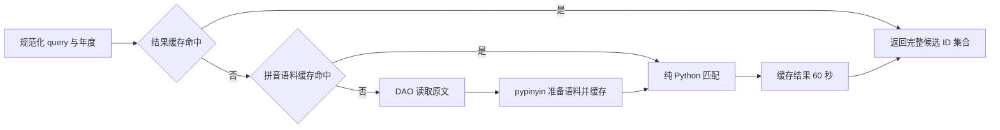

# 拼音候选搜索后端化设计

> 状态：用户已确认，两个同名分支已本地实现；未发布或部署。2026-11-08。
> 已确认方向：使用 pypinyin 提供读音，在项目内实现需要的匹配行为，不引入 JS 运行时。
> 模块位置、接口、缓存和前端接入方案均已确认；第二阶段经用户确认统一到 `/autocomplete/search`，下文描述当前方案。

## 1. 目标与当前实现

将投票页的角色、音乐和 CP 成员选择中的拼音匹配移到 Python 后端。后端统一处理公开候选的名称、别名、作品或专辑搜索，前端保留展示、筛选、排序和个人已选项处理。

代码基线：后端分支 `feat/pinyin-backend-search`，`265ab63`，已包含 `origin/main` 的 `6d8afc1`；前端同名分支指向 `ef028e0`，与调研时的 `origin/dev` 一致。实施前已归档并 stash 前端 `fix/codegen-exit-status` 未提交现场，切到同名功能分支，并保留尚未被上游包含的本地改动。

迁移前前端使用 `pinin@0.2.0`。角色和 CP 成员共用 `characterSearch.ts`；音乐由 `musicSearch.ts` 创建搜索器。迁移前后端 `apps/autocomplete` 只有名称 ILIKE 和 60 秒响应缓存，响应没有候选 ID；第二阶段用候选搜索契约替换旧接口，移除旧建议实现。结果页正则筛选不使用 Pinin，本次不改。源码和迁移目录没有现成拼音字段；本次不据此声称线上数据库已核验。

## 2. 路线与取舍

| 路线 | 优点 | 代价与结论 |
|---|---|---|
| pypinyin 加项目内匹配器 | 成熟词典、纯 Python；规则可审阅；可导出派生拼音 | 需要维护匹配算法和行为测试；用户已认可此方向 |
| PinInPy | 搜索接口接近现有 Pinin | 已发现 Python 3.13 导入错误和模糊规则差异，需要维护封装或原生补丁；暂不采用 |
| 后端 JS Pinin | 易沿用现有行为 | 增加运行时及进程边界；用户已排除 |

拼音存储仍有两个可行选择：

- **推荐首版保存在 Redis**：拼音是候选原文的派生语料，可随时重新生成；与搜索结果一起复用现有失效前缀，无数据库迁移。
- **新增数据库派生字段**：适合后续需要管理读音、审阅或离线导出的场景，但需要 schema、写入同步和回填。当前尚无这类已确认需求，本轮不实施。

首版不创建拼音表、任务队列、锁、后台构建任务或跨进程索引同步机制。也不添加 Python 进程级候选缓存，避免额外失效状态。

## 3. 模块位置与依赖

放在唯一实际消费者 `src/apps/autocomplete/` 内，不提前抽到 `common`，也不新增顶级子系统。

| 文件 | 职责 |
|---|---|
| 新增 `src/apps/autocomplete/pinyin.py` | 纯 Python 的读音准备、21 条规则和文字匹配；不依赖 DAO、Redis、FastAPI |
| 更新 `src/apps/autocomplete/service.py` | 候选搜索用例：加载语料、调用匹配器、使用公共 Redis 缓存 |
| 修改 `src/apps/autocomplete/dao.py` | 按请求年度读取候选搜索字段；移除旧 ILIKE 查询和空 CP 方法 |
| 修改 `src/apps/autocomplete/schemas.py` | 新接口的显式请求和响应 |
| 修改 `src/apps/autocomplete/router.py` | 唯一 `/search` 路由与依赖注入，返回候选 ID 契约 |
| 复用 `src/common/cache.py` | JSON 缓存及前缀失效；不扩展成新的缓存框架 |

依赖方向：router → service → DAO / pinyin / common.cache；pinyin 只依赖标准库和 `pypinyin==0.55.0`。`service.py` 只承载候选搜索；旧建议模型和临时候选路由均已移除。

前端在 `packages/shared/api/candidateSearch.ts` 放无框架请求函数，在 `packages/vote/src/common/lib/useCandidateSearch.ts` 放 Vue 请求状态；三个选择入口复用这两处逻辑。

## 4. 匹配契约

### 4.1 搜索范围

| 类别 | 独立搜索文本 |
|---|---|
| character | `name`、每条 `aliases`、关联 `work.name` |
| music | `name`、每条 `aliases`、关联 `work.name`（当前主专辑） |

任一文本匹配即命中同一候选，按 candidate ID 去重。不同文本之间不能拼接出一个命中。`name_jp` 和 `include` 当前未显式加入前端 Pinin 索引，首版不顺带扩展；假名、英文若已出现在上述字段中，支持原文匹配。

CP 页面复用 character 搜索来选择成员；不搜索已提交的 CP 组合，不实现 B-062。年度只影响候选关联，不修改 voteable ID 或 candidate ID。

### 4.2 输入与读音

- 查询和语料均采用 `lower()`；查询仅去首尾空白，内部空格、标点和数字保留，不作为正则解释。
- 查询原始长度最多 64 个 Unicode 码点；超长返回 422，不截断后继续搜索。空白查询视为空查询。
- 每个原文字位置保存原字和零到多个读音。使用 pypinyin 的逐字、无声调、多音字模式；不把每个字的所有读音预先做整词笛卡尔积。
- 字典能提供读音的字使用这些读音，其他字符保持原文。大小写处理后的原字始终可以直接匹配。
- 为接近现有 Pinin，声母／韵母拆分按其 standard 模式的字面规则：优先 `zh/ch/sh`，其余非 `a/e/i/o/u/v` 开头取首字母为声母；保留 `y/w` 输入。不能直接用 pypinyin 严格 `INITIALS` 输出代替该逻辑。
- `ü` 在拼音表示中统一为 `v`。不在整段用户输入上做全局 `sh→s` 等替换。
- 首版不支持声调数字、双拼、注音输入和通用拼写纠错。字典内容与旧 Pinin 不同可能造成少量读音差异，按下述样例和实际反馈核对，不承诺完全复刻旧引擎。

### 4.3 模糊规则

保留 `common/lib/pinin.ts` 的 7 条双向关系及 14 条单向关系：

```text
双向：sh|s, ch|c, zh|z, u|v, ang|an, eng|en, ing|in
单向：an>a, ang>a, ai>a, ao>a, ou>o, ong>o, en>e, eng>e,
      ei>e, er>e, er>r, ui>u, un>u, vn>v
```

规则作用于单个读音的声母或韵母；双向生成两个方向，单向只允许原音素到配置的替代形式。每条规则对原音素做一次首处替换，不递归应用，不求规则的传递闭包。保留原音素。这样不会因一次规则替换又触发另一条规则而扩大匹配范围。

### 4.4 匹配过程

按原文位置和查询位置推进，可从任意原文位置开始。每个字可消费原字、完整读音或完整声母；查询结束时允许停在某个读音音素的前缀处。声母和韵母分别应用规则后组成读音。字与字之间连续，不跳过任意原文字，不跨搜索字段。

使用记忆化的查询位置匹配或等价的二维动态规划，避免反复探索相同位置；这是混输匹配的核心算法，不引入业务请求状态机。先逐条遍历候选，不构建搜索树或倒排索引。准备好的语料在同一次搜索和 Redis 缓存中复用。

核心接口：

```python
# pinyin.py：TextUnit 是原字与 (声母, 韵母) 候选的不可变结构。
PreparedText = tuple[TextUnit, ...]
def prepare_text(text: str) -> PreparedText: ...
def contains(text: PreparedText, query: str) -> bool: ...
```

必须保留的独立预期值：

| 原文 | 查询 | 结果 |
|---|---|---|
| 雾雨魔理沙 | `mls`、`wuyumolisha`、`mo理sha` | 命中 |
| 博丽灵梦 | `灵m`、`博l灵m` | 命中 |
| 十六夜咲夜 | `siliuye` | 命中 |
| 二小姐 | `rxiaojie` | 命中 |
| 路米 | `lvmi` | 命中，检查 u→v 方向 |
| 绿米 | `lumi` | 命中，检查 v→u 方向 |
| 灵米 | `limi` | 不命中，不能将 ing 任意缩成 i |
| 小米 | `ximi` | 不命中，不能将 iao 任意缩成 i |
| Bad Apple!! | `bad apple` | 命中 |
| U.N.オーエンは彼女なのか？ | `オーエン` | 命中原文 |
| 魔甲理沙 | `mls` | 不命中，不跳过甲 |

多音字、规则方向、末尾未输完和原文分支的独立覆盖放在同一层测试，不在前后端重复整套算法场景。旧 Pinin 只用于一次性对照调查，不能成为永久测试依赖，也不能把新实现自己的输出当预期值。

## 5. 新接口与数据访问

唯一入口为 `POST /api/v1/autocomplete/search`。第二阶段替换旧 suggestions 契约，不再保留限量 ILIKE 建议或临时候选路由；仓库内未发现旧建议业务调用方。这一契约变更已获用户确认。

```json
请求：{"category":"character","query":"mls","vote_year":12}
响应：{"category":"character","query":"mls","vote_year":12,"candidate_ids":[123]}
```

示例 ID 123 仅表示响应形状，不代表已核验的云端候选。

- `category` 只能为 `character` 或 `music`；`query` 必填字符串、允许空串、最多 64 码点；`vote_year` 可省略，省略时使用 `settings.vote_year`，显式给出时须为正整数。
- 响应回显规范化 query 和实际 vote_year。candidate IDs 为整数，稳定升序、无重复。
- 返回完整命中集合，不设默认 10 条截断，不新增分页。空查询返回该年度该类别全部 candidate IDs；未知年度返回空集合。
- 不带用户已选项、用户身份、筛选项或排序参数。前端将 ID 转为字符串，与已加载对象求交集后继续已有筛选和排序。
- 新接口与旧公开候选接口一样公开读取，不改变现有鉴权和提交规则。

数据层新增：

```python
# dao.py；构造函数只接收 session，查询年度显式传入。
async def load_search_documents(
    self, category: Literal["character", "music"], vote_year: int
) -> list[tuple[int, tuple[str, ...]]]: ...
```

DAO 经 candidate → voteable → work JOIN 返回搜索原文，直接使用数据库 aliases；不查询选票或静态白名单。它与现有候选列表查询用途不同，只取候选 ID 和搜索字段；不为这一次查询重构投票对象模块。

## 6. Redis 与派生拼音存储

`CandidateSearchService(dao, redis, default_year)` 提供 `async search(request: CandidateSearchRequest) -> CandidateSearchResponse`。规范化查询后，处理流程如下：



使用已有 `autocomplete:` 前缀，内部版本初始为 `v1`：

| 内容 | key | TTL |
|---|---|---|
| 原字及按位置排列的声母／韵母候选 | `autocomplete:pinyin:v1:{year}:{category}:corpus` | 60 秒 |
| 完整命中 ID 列表，包括空结果 | `autocomplete:pinyin:v1:{year}:{category}:q:{sha256(query)}` | 60 秒 |

语料以 JSON 列表存储 candidate ID、独立文本和每个位置的原字／读音二元组。只保存当前年度该类别的搜索字段，不保存图片、音频、票数或个人已选项。按位置保留多音候选，不展开完整读音组合；序列化和恢复逻辑只留在 service.py。空查询直接由语料取全部 ID，不另外写 query 结果键。

规则或内部语料格式变动时将内部版本升为 `v2`；这只是代码常量，不新增数据库版本字段。依赖版本固定为 pypinyin 0.55.0，升级时核对读音差异并同步缓存版本。

### 失效与故障行为

- 复用管理写入后的 `_clear_vote_objects_cache()`：其已有 `autocomplete:` 前缀清理会同时移除语料和结果。实施时核对候选变更、导入、作品修改、别名修改是否均接入该调用。
- 管理端现有 `scope=autocomplete` 手动刷新覆盖新缓存；`scope=vote_objects` 仍只清自己的 scope，不能声称它单独也会清拼音结果。
- 复用 `cache_get_json` / `cache_set_json`。Redis 不可用时直接从 DAO 准备和匹配，跳过缓存写入；不伪装成零命中。数据库失败沿用项目错误响应，不将错误写成成功空结果。
- 不创建分布式锁、等待队列、单飞协调或自动恢复任务。并发 miss 可以各自计算；管理变更与读写交错的短暂陈旧允许由 TTL 或手动刷新处理。
- 没有触发正常失效时，两层缓存可能接续陈旧，保守按最多约 120 秒理解，不能宣称数据总在 60 秒内更新；频繁改名或严格即时更新需求出现后再单独讨论。
- 现有 `result:*` 是计票产物，与这次缓存无关，不加入任何清理操作。

## 7. 前端接入

前端请求使用 `${API_PREFIX}/api/v1/autocomplete/search`，即 `/v12-be/api/v1/autocomplete/search`。已核对 Vite 与 `Dockerfile.vote.template` 的通用 `/v12-be/` 转发：均剥离该前缀后到达后端 `/api/v1/...`。因此无需增加代理路径或改变部署拓扑。

新增共享函数：

```typescript
type CandidateCategory = 'character' | 'music'
type CandidateSearchResult = {
  category: CandidateCategory
  query: string
  vote_year: number
  candidate_ids: number[]
}
function fetchCandidateSearch(
  baseUrl: string,
  category: CandidateCategory,
  query: string,
  voteYear: number,
): Promise<CandidateSearchResult>
```

`baseUrl` 在此指完整的搜索端点 URL；helper 不再追加路径。请求沿用已有同源 API 的 `credentials: 'include'`，发送 JSON POST。

Vue 层统一 `useCandidateSearch(category, query: Ref<string>)`，使用当前 `voteYear` 和 API_PREFIX。返回 `matchedIds: Ref<Set<string>>`、`loading: Ref<boolean>`、`error: Ref<string | null>`。不缓存历史 query 结果，不持久化浏览器搜索缓存。

- 保留输入端现有 100ms 节流，不叠加另一套 debounce。公共输入框 `CandidateSearchInput.vue` 与 CP 输入框增加 `maxlength=64`；后端仍独立校验码点长度。空查询立即展示本地已有列表，不发搜索请求。
- 角色／音乐列表和 CP 选择框以公共命中 ID 集合过滤当前列表；已选项目的排除、类别／作品筛选、日期排序及 CP 允许重复成员等规则不变。
- 非空查询等待期间清除上一关键词的命中列表，显示“正在搜索…”；失败显示“搜索失败，请修改关键词重试”，清空关键词可继续浏览全部列表。不自动重试，不回退第二套拼音引擎。
- 使用 Vue watch 的 cleanup 忽略过期请求返回，确保快速输入或清空后旧结果不会盖掉当前结果；不增加请求队列、版本恢复或持久化状态。
- 请求 helper 检查 HTTP 状态、category/year/query 回显及 ID 数组，再更新 Vue 状态。这是新异步搜索的核心响应契约，不扩展到无关请求。
- 三个选择框都显示上述等待／失败状态。本命从已投选项中选择的现有流程不改。
- 候选对象仍由已有 vote-objects 数据源加载；移走 Pinin 词典与计算，不代表免除列表展示和导图所需的对象数据下载。

完成三处接入后才移除 `pinin` 依赖和 `pinin.ts`、`musicSearch.ts`。`characterSearch.ts` 中的排序、作品筛选函数保留；仅删除已无调用的 Pinin 构建与 searchAndSort。现有 musicSearch 测试按新职责替换或删除，不能保留只断言已删除实现的测试。

## 8. 验证、兼容和回滚

实施分为三个交付段：纯匹配器；后端公开搜索与缓存；前端三个入口替换。只有整个链路完成后才能声称迁移完成。

- 核心匹配在一个 Python 单测文件中覆盖，以明确正反例锁定原文、简拼、混输、规则方向和多音字；不为同一算法在前端再复制一套。
- 后端集成层使用现有 SQLite／fakeredis 测试条件，覆盖年度和类别、别名／作品独立匹配、完整集合与候选 ID、缓存命中／空结果／失效／Redis 不可用。
- 前端用现有 node:test 与 tsx 工具覆盖真实请求 helper、ID 映射、错误和过期返回；不建立新的端到端测试工程。UI 按项目约定最多截图，不自动点击或填写表单。
- 不以小样本全部相同证明完全兼容；若关键名字或常见输入与预期不符，先明确字典差异还是匹配错误，再调整该用例或将产品差异交用户确认。
- 初次迁移前的 Pinin 前端不使用此接口；第一阶段与第二阶段的前后端须分别配套发布，不能混用路径与契约。前端不保留第二套本地拼音引擎。
- 回滚前后端到同一阶段的配套版本；数据库与投票记录无需回滚。新 Redis 键可自然过期或用原 autocomplete scope 清理。无数据迁移、真实回填或重新计票。

## 9. 实施状态与剩余验证

2026-11-08 用户确认了模块边界、新 ID 接口、两层 Redis 缓存及前端接入方案。纯匹配器、DAO、API、缓存、三个选择入口和依赖替换均已本地实现。第一阶段后端 `77f43cf`、前端 `26f79df` 已分别提交；随后用户确认统一接口与命名，第二阶段见 [收敛计划](../plans/2026-11-08-autocomplete-search-consolidation.md)。

已验证关键匹配正反例、年度／字段隔离、缓存与失效、Redis 故障直算、HTTP 输入输出及前端请求竞态。最终命令与结果见 [实施计划](../plans/2026-11-08-pinyin-candidate-search.md) 执行记录。

未进行线上数据查询、真实链路部署或浏览器交互验收；本次不包含这些授权。两端无关本地改动继续保留；旧 CP 空实现随建议链路移除，不表示实现了 CP 组合推荐。

参考：[pypinyin 用法](https://pypinyin.readthedocs.io/zh-cn/master/usage.html)、前端 `ef028e0` 的 `pinin.ts` / `characterSearch.ts` / `musicSearch.ts`。官方需求中的角色和音乐拼音搜索见 `docs/requirements/VoileLabs-人气投票项目-需求文档-投票系统.md` 的角色选择框与曲目选择框。
